# THỰC HÀNH BÀI 5: PHÂN TÍCH VÀ KIỂM THỬ BẢO MẬT

Họ và tên: Đoàn Xuân Hướng — Lớp 23DATA1 — MSSV 2387700025

## 1. SAST-TOOL

### 1.1 Cài đặt gói

```powershell
pip install -r .\requirements.txt
```

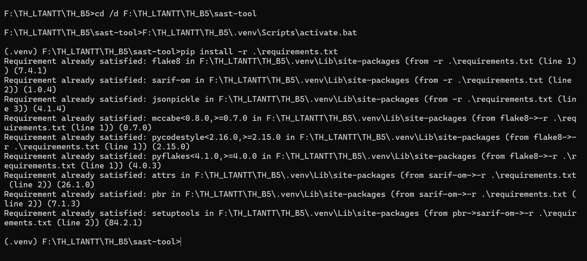

### 1.2 Chạy Unit Test

```powershell
python -m unittest discover tests
```

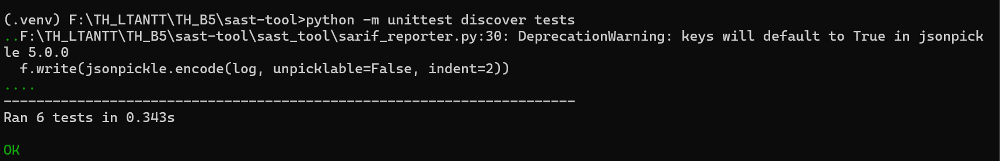

### 1.3 Quét file code không an toàn thứ nhất

```powershell
python -m sast_tool.main .\examples\vulnerable_01.py
```

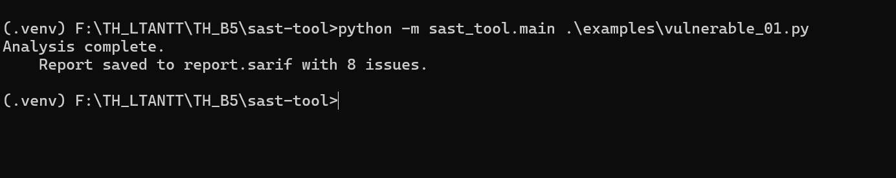

### 1.4 Xem báo cáo SARIF

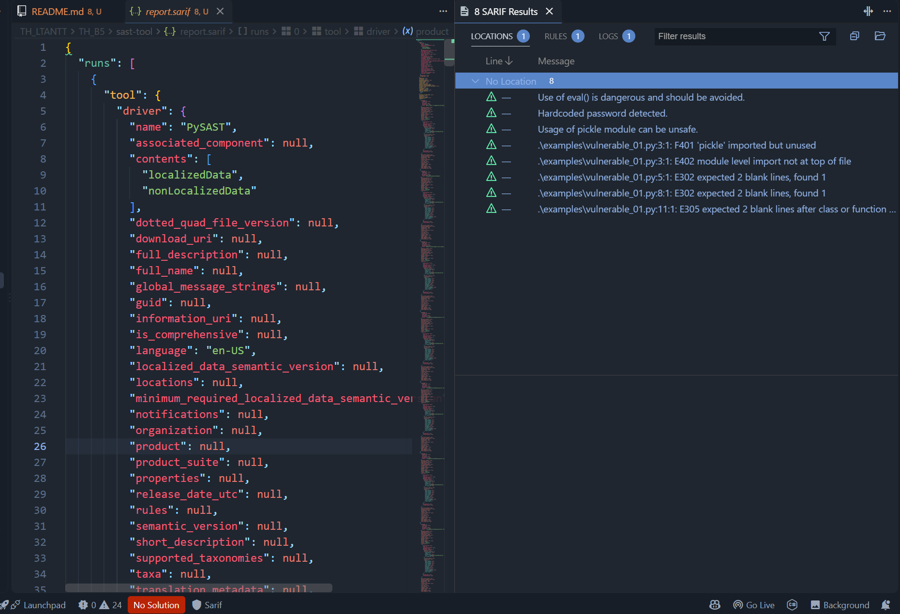

### 1.5 Quét file code không an toàn thứ hai

```powershell
python -m sast_tool.main .\examples\vulnerable_02.py
```

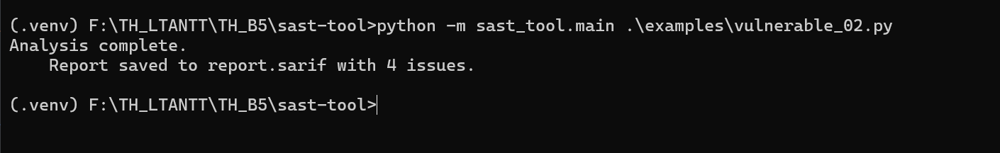

---

## 2. Git: commit + push phần SAST (có chặn nhạy cảm)

```powershell
cd F:\TH_LTANTT\TH_B5
git add sast-tool
git commit -m "[add] sast tool"
```

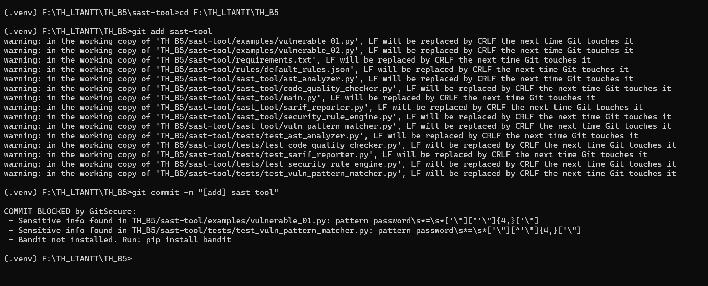

### 2.1 Xoá thông tin nhạy cảm

- `sast-tool\examples\vulnerable_01.py` dòng 1 — thay giá trị trong ngoặc kép thành:

```
password = "123"
```

- `sast-tool\tests\test_vuln_pattern_matcher.py` — dòng `code = 'password = ...'`,
  thay chuỗi mẫu bằng `"abc"` (để unit test vẫn chạy đúng):

```
code = 'password = "abc"'
```

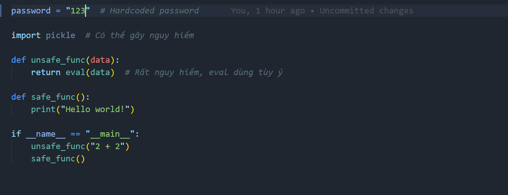

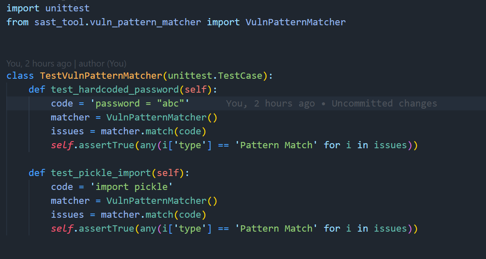

### 2.2 Commit và push

```powershell
git add sast-tool
git commit -m "[add] sast tool"
git push origin main
```

Commit `[add] dast tool` bao gồm cả `sast-tool` và `dast-tool` (32 files changed,
840 insertions) và đã được push lên GitHub.

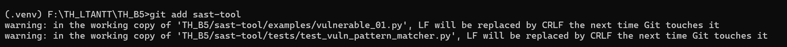

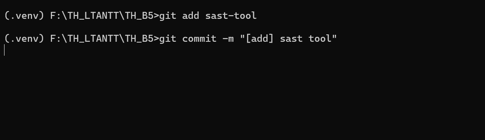
---

## 3. DAST-TOOL

### 3.1 Cài đặt gói

```powershell
cd F:\TH_LTANTT\TH_B5\dast-tool
F:\TH_LTANTT\TH_B5\.venv\Scripts\activate.bat
pip install -r .\requirements.txt
```

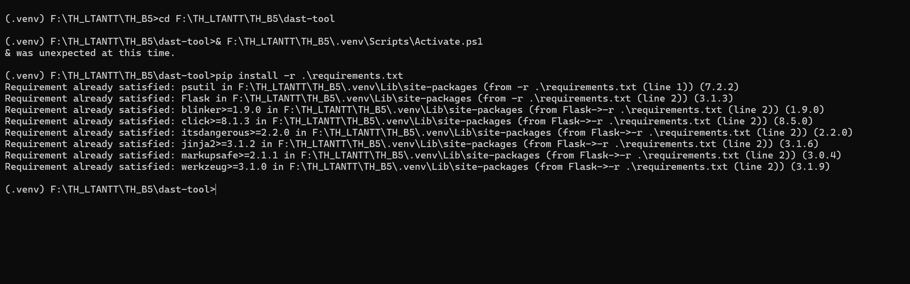

### 3.2 Chạy Unit Test

```powershell
python -m unittest discover -s tests
```

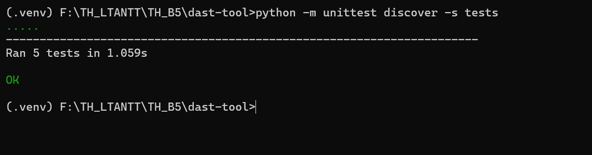

### 3.4 Chạy main.py (giám sát runtime)

```powershell
python .\main.py
```

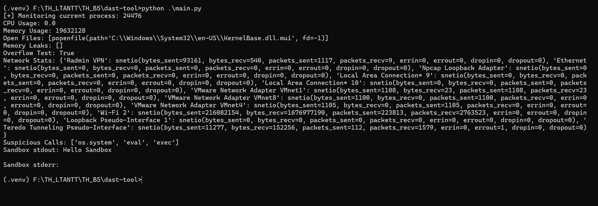

### 3.5 Giám sát với Flask API

**Cửa sổ 1** server chạy nền:

```powershell
python .\app.py
```
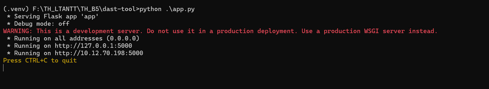

```powershell
Invoke-RestMethod http://127.0.0.1:5000/api/monitor
Invoke-RestMethod http://127.0.0.1:5000/api/memory
Invoke-RestMethod http://127.0.0.1:5000/api/security
Invoke-RestMethod http://127.0.0.1:5000/api/network
Invoke-RestMethod -Uri http://127.0.0.1:5000/api/sandbox -Method Post -ContentType 'application/json' -Body '{"command":"echo Hello Sandbox"}' | Format-List
```

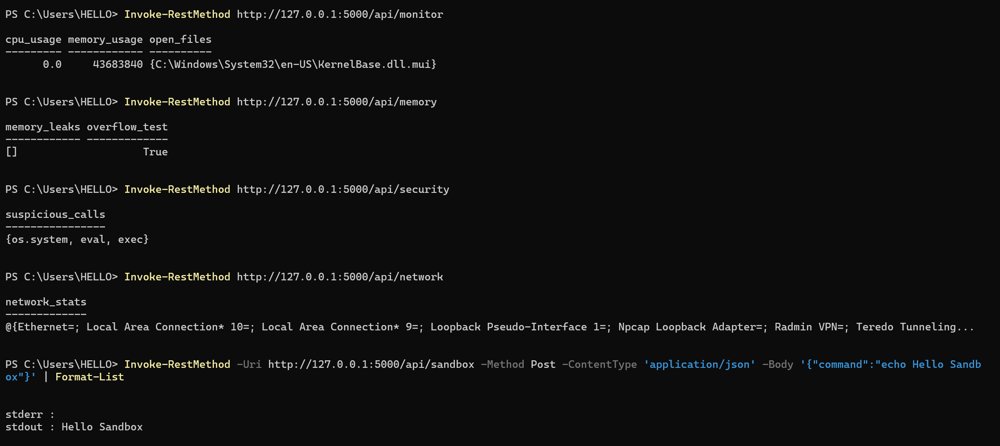

---

## 4. Git: commit + push phần DAST

```powershell
cd F:\TH_LTANTT\TH_B5
git add dast-tool
git commit -m "[add] dast tool"
git push origin main
```

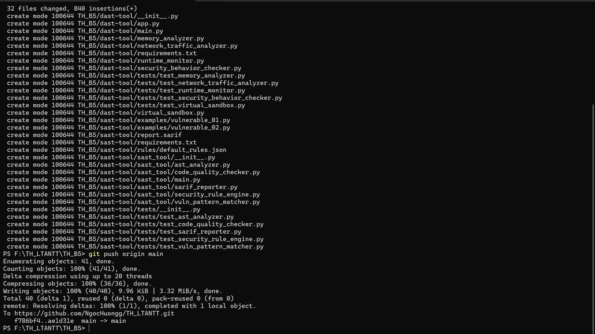
